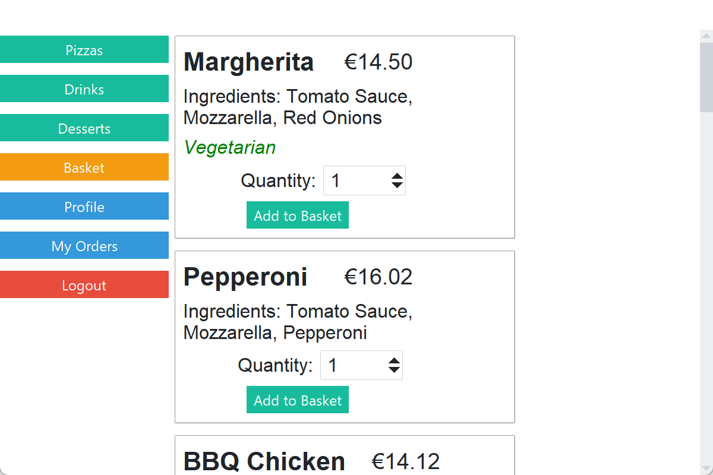
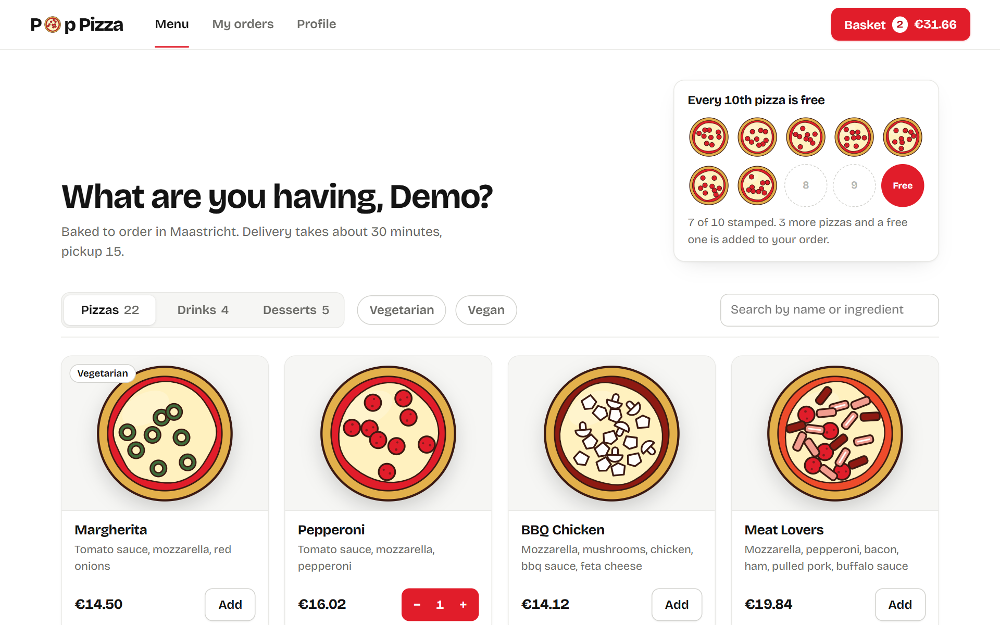
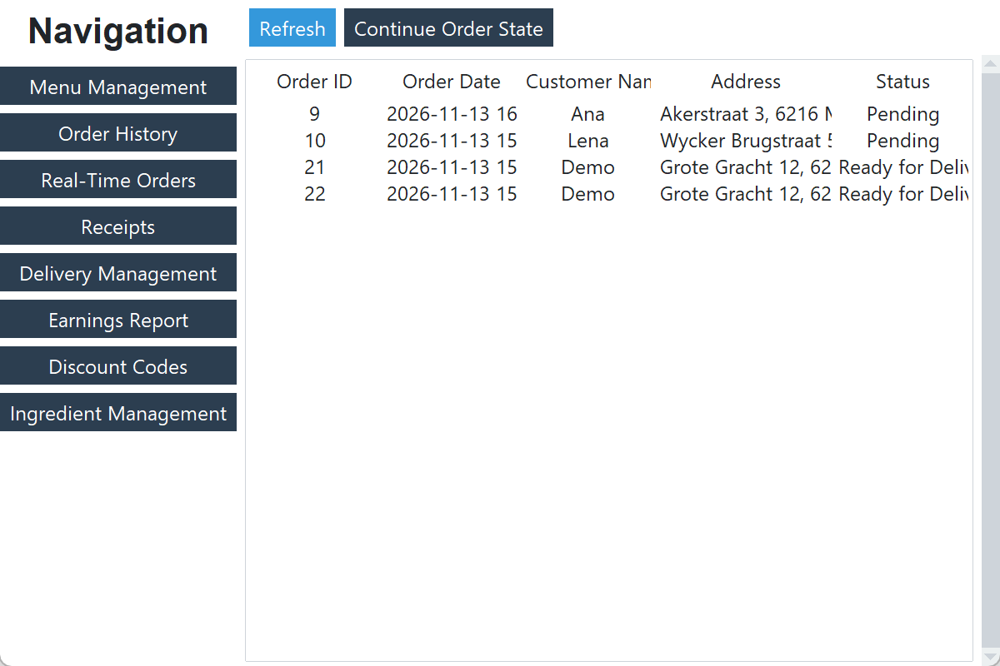
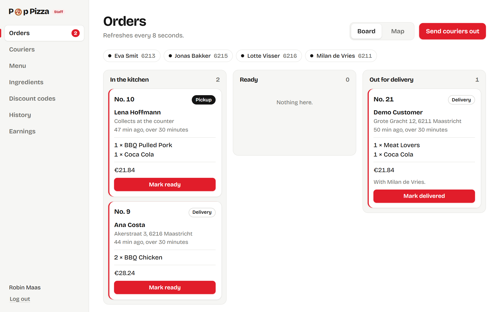

# Pizza ordering system

A pizza shop on a MySQL database, built for the Databases course at Maastricht University (2024). Customers order through one app, staff run the kitchen, deliveries and reporting through another; both share a 16-table relational schema.

It has two interfaces on the same database and the same ordering logic: the original desktop apps from 2024 and a web interface added in 2026.

## Old and new interface

| 2024, desktop (Tkinter) | 2026, web |
| --- | --- |
|  |  |
|  |  |

More of the web interface: [login](docs/screenshots/new-login.png), [basket](docs/screenshots/new-basket.png), [order tracking](docs/screenshots/new-orders.png), [delivery map](docs/screenshots/new-map.png), [menu editor](docs/screenshots/new-menu-editor.png), [earnings](docs/screenshots/new-earnings.png), [phone](docs/screenshots/new-mobile.png).

The web interface (`web_app/`) is vibe coded: I directed the design and an AI assistant wrote the code. It does not replace the course work. Logging in, the menu, the basket, prices, discount codes, the loyalty count and placing or cancelling an order all run through my original classes in `customer_app/`. The staff pages repeat the SQL and the rules of `staff_app/`, because that code lives inside the Tkinter screens and cannot be imported.

What the web interface adds on top:

- Every pizza is drawn from its ingredient list in the database, so a new pizza gets a picture the moment staff save it
- A basket that slides in as a receipt, a stamp card for the loyalty count, and order tracking with a five-minute cancel countdown
- A staff board with the orders in three columns (in the kitchen, ready, out for delivery) that refreshes on its own and announces new orders
- A delivery map for staff: a street map (Leaflet with OpenStreetMap tiles) with a pin for every open delivery, coloured by status, and a line from the shop to orders that are on the road
- Search on the menu by name or ingredient
- A menu editor that shows the pizza and its calculated price while ingredients are ticked
- An earnings page with a chart per day and a split by gender
- Works on a phone and keeps animation to a minimum when the device asks for reduced motion

## What it does

**Customer app**
- Register and log in (passwords stored as SHA-256 hashes)
- Menu of pizzas, drinks and desserts with vegetarian and vegan labels and the ingredients of each pizza
- Basket with discount codes, a birthday discount and a loyalty reward: every 10th pizza is free
- Prices built from the ingredients plus a 40% margin and 9% VAT
- Order confirmation, estimated delivery time, order history and cancellation

**Staff app**
- Real-time and active orders, with status updates from pending to delivered
- Delivery management: orders grouped by postal code and assigned to available couriers
- Menu, ingredient and discount code management
- Order history, receipts and an earnings report with charts

## Database

16 tables: customers, orders and order items, pizzas with their ingredients, drinks, desserts, menus, discount codes, couriers, delivery assignments and postal areas. The schema is in [db/schema.sql](db/schema.sql); [db/seed.sql](db/seed.sql) fills it with the menu and made-up customers and orders.

## Stack

Python · MySQL (mysql-connector-python) · Tkinter with ttkbootstrap and matplotlib for the desktop apps · FastAPI with plain HTML, CSS and JavaScript for the web interface

## Run it

Requirements: Python 3.10+ and MySQL 8 or MariaDB (tested with MariaDB 11.4).

```
mysql -u root -p < db/schema.sql
mysql -u root -p < db/seed.sql
pip install -r requirements.txt
```

Set the database login (`DB_HOST`, `DB_PORT`, `DB_USER`, `DB_PASSWORD`, `DB_NAME`; see `.env.example`), then start what you want from the repository root:

```
set DB_PASSWORD=your-mysql-password      # macOS/Linux: export DB_PASSWORD=...

python -m web_app                        # web: shop at http://127.0.0.1:8000, staff at /staff
python -m customer_app.main              # desktop customer app
python -m staff_app.main                 # desktop staff app
```

The map looks up each delivery address once at OpenStreetMap (Nominatim) and keeps the answer in `web_app/geocache.json`. Set `MAP_GEOCODING=0` to keep addresses on your machine; pins then sit in the middle of the postal area. `SHOP_LAT` and `SHOP_LNG` move the shop (default: Markt, Maastricht).

Customers log in as `demo` / `demo`, staff (web only) as `staff` / `staff`. On Windows, `set DB_HOST=127.0.0.1` makes connecting faster than the default `localhost`.

## Note

The original GitLab repository is no longer accessible, so this code was recovered from my last saved versions (October 2024). Running it end to end afterwards turned up bugs in that last version, which are fixed here:

- Placing an order crashed on a half-finished loyalty change, and order items were all stored as pizzas
- The basket and the order used two different price formulas, both adding VAT and margin on top of menu prices that already include them; a discount code applied in the basket never reached the order, and the birthday discount was subtracted after the total was saved
- The free 10th pizza was never added (it looked for a menu item that did not exist)
- Staff could not add menu items (the save step had lost its button), and new pizzas were never marked vegetarian or vegan
- The earnings report showed no ages unless an age filter was set

The database login now comes from environment variables and the library versions are pinned to those of 2024. All people and orders in the example data are made up.
